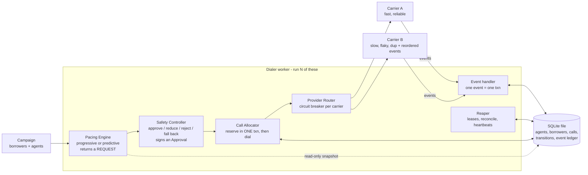
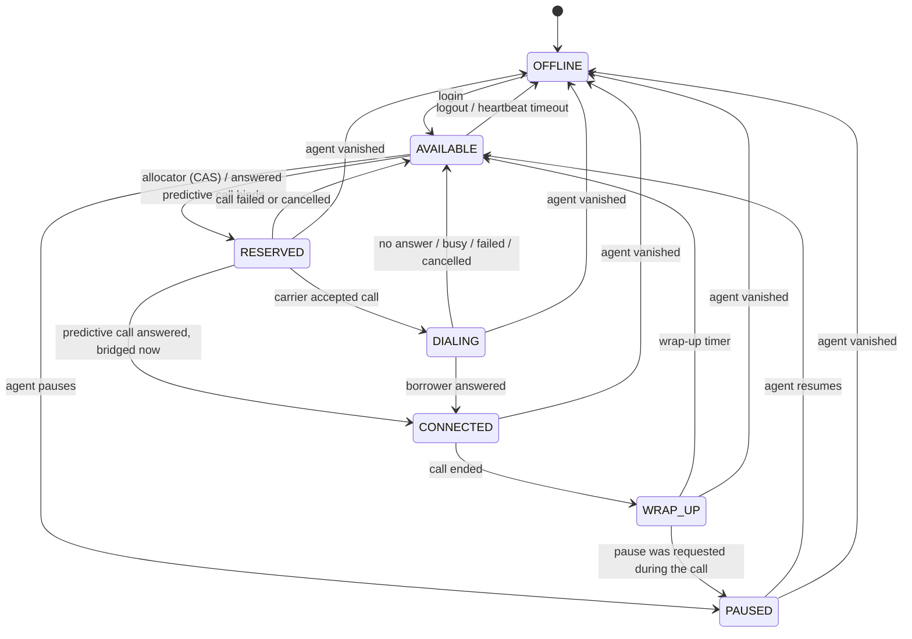
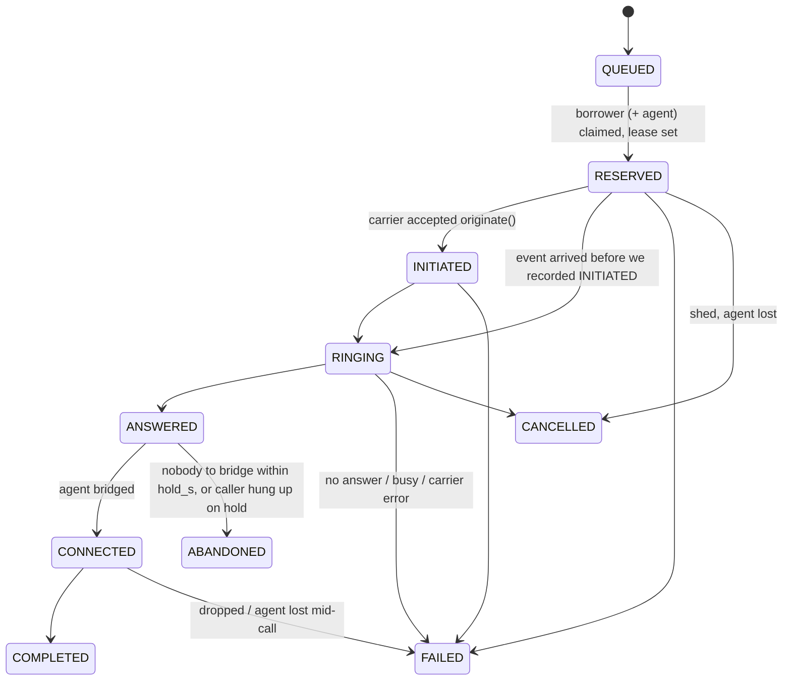

# Architecture

## 1. The pipeline



Everything a worker knows lives in the database. A worker keeps no state that matters between ticks, so killing one loses
nothing and adding one needs no coordination beyond the database itself.

One tick of a worker (`dialer/engine.py`):

1. Pull carrier events and apply each in its own transaction.
2. Move agents out of wrap-up, drop agents whose heartbeat went quiet, match answered-but-waiting calls to free agents.
3. Reaper: look at calls whose lease expired and reconcile them with the carrier.
4. Take one snapshot of the campaign.
5. Shed ringing calls we can no longer cover (only after an availability drop).
6. Pacing proposes. Safety decides. Only an approval reaches the allocator.

## 2. Agent state machine



The legal pairs are a set in `dialer/models.py`. `repo.agent_transition` is the only function that writes `agents.state`,
and it raises on anything not in the set (`tests/test_agent_state.py` tries every pair of states).

### How two workers are stopped from reserving the same agent

Three layers, each enough on its own for the case it covers:

1. **Compare-and-set.** The reservation is `UPDATE agents SET state='RESERVED', version=version+1 WHERE id=? AND
   state='AVAILABLE' AND version=?`. The loser sees zero rows changed and moves on. Both workers can read the same
   AVAILABLE row at the same instant; only one UPDATE matches. `test_two_workers_cannot_reserve_the_same_agent` runs 16
   threads at one agent behind a barrier and asserts exactly one winner.
2. **Reserve in one transaction.** Agent, borrower and call row are created together or not at all, so there is no
   window where an agent is "reserved" without a call that explains why.
3. **Database backstop.** A partial unique index (`one active call per agent`, and the same for borrowers) makes the
   database itself refuse a second live call. If my application logic has a bug, I get an exception, not a double-booked agent.

Postgres version of layer 1: `SELECT ... FROM agents WHERE state='AVAILABLE' FOR UPDATE SKIP LOCKED LIMIT n`. Workers
skip rows another worker holds instead of queueing behind them. The CAS stays as the second line of defence.

If a cache says RESERVED and the database says AVAILABLE: the database wins. There is no cache in this design. If you
add one, it is only ever a hint for picking candidates; the CAS against the database is what decides.

## 3. Call state machine



The rule that makes events safe (`call_transition_allowed` in `dialer/models.py`):

* States have a rank: QUEUED < RESERVED < INITIATED < RINGING < ANSWERED < CONNECTED.
* A live call may move to any strictly higher rank, skipping steps if the carrier skipped them.
* A live call may move to any terminal state (COMPLETED, FAILED, CANCELLED, ABANDONED).
* A terminal state never changes. First one to arrive wins.
* Anything else is stale and is recorded as ignored.

On top of that, `provider_events` has `PRIMARY KEY (call_id, event_type)`. The first insert wins and later ones are
`DUPLICATE`. The insert and the state change are in the same transaction, which matters for crashes (below).

What the brief's examples do (these are real outputs from `python -m sim.failures`):

| Events arrive as | Result |
|---|---|
| RINGING, ANSWERED, ANSWERED, ANSWERED, RINGING, COMPLETED, COMPLETED | 3 applied, 4 duplicates. Exactly one transition per state. Agent ends in WRAP_UP. |
| ANSWERED, RINGING, COMPLETED | RINGING is stale and ignored. Call ends COMPLETED, agent WRAP_UP. |
| COMPLETED, ANSWERED, RINGING | COMPLETED applies. The later two hit a terminal call and are ignored. We never saw ANSWERED, so we cannot prove an agent was bridged. The call is flagged abandoned (the pessimistic choice) and the agent goes back to AVAILABLE. |
| FAILED(no answer), ANSWERED | The call is already FAILED. The late ANSWERED means a human picked up a call we had given up on. We hang up and count it as an abandoned answered call. |

Worker crashes right after ANSWERED:

* Crash before commit: the transaction rolls back, including the dedup row. Nothing was applied. The carrier
  redelivers ANSWERED (or the reaper polls `lookup`), and it applies normally. If COMPLETED arrives first, the
  COMPLETED row above applies and the late ANSWERED is ignored.
* Crash after commit: everything was applied. COMPLETED arrives later and is handled by any worker.
* Side effects (cancel, hang up at the carrier) run after commit and are idempotent, so a crash between commit and
  effect only delays them. The reaper catches the rest.

## 4. Predictive pacing, in plain words

Two questions, answered with a Beta-smoothed answer rate and a binomial calculation. No ML.

1. **How many agents will be free when a call I dial now gets answered?**
   `supply = free now + agents finishing wrap-up soon + connected agents x P(finish within setup time)`.
   Setup time is the recent average time from dialing to answer (about 12s). Talk time is treated as memoryless, so
   `P(finish within H) = 1 - exp(-H / mean_talk)`.
2. **How many calls can be ringing before too many answers would be left with no agent?**
   If `n` calls are ringing and each is answered with probability `p`, answers are Binomial(n, p). The expected number
   of answered callers with no agent is `E[max(0, X - supply)]`. Pick the largest `n` where that, divided by the
   expected number of answers, stays under a small tolerance (`eps`). That is the target number of calls in flight.

The request is `target - calls already in flight`. Every decision keeps its reasoning. This is a real decision from a
100-agent run (30% answer rate, 120s talk), pacing first:

```
p_hat=0.23 supply=20.7 (free 1 + wrap_soon 7 + connected_frees 12.69) -> can hold 72 calls in flight at <= 1.5%
expected abandon; 13 already in flight -> dial 59
```

and the Safety Controller's reply to that request:

```
REDUCE 59 -> 5: capped by safe ceiling 18 (p_safe=0.27, supply_safe=18.15, eps=0.0, abandon_rate=0.0244)
```

Pacing was optimistic (72 calls in flight is fine at p=0.23). Safety used a higher answer rate and a lower supply, and
because the recent abandon rate (2.4%) was already above our own 2% target, its tolerance had shrunk to zero. So it
let 5 through, not 59.

That is how you answer "why 17 calls and not 10". Both lines are stored in the `decisions` table for every tick that
asked for or approved a call.

### The Safety Controller (`dialer/safety.py`)

It never uses the pacing engine's numbers, only its request. It recomputes from the snapshot with pessimistic inputs:

| Input | Pacing uses | Safety uses |
|---|---|---|
| Answer rate | posterior mean of last 200 | max(90% upper bound of last 200, 80% upper bound of last 30) |
| Connected agents that will free up | full credit | 80% credit; free-up estimate is floored, not rounded |
| Tolerance `eps` | 1.5% | 1.5% x (1 - abandon_rate / 2%), so it shrinks to zero as we approach our own target |

Then it does one of four things:

* **APPROVE**: the request fits under the safe ceiling.
* **REDUCE**: part of it fits. It issues a smaller approval.
* **REJECT**: nothing is safe. Carrier down, campaign inactive, no borrowers, rate limit, or no safe capacity.
* **FALLBACK_PROGRESSIVE**: it ignores the predictive request and approves one reserved-agent call per free agent.
  Triggers: not enough call history (cold start), carrier degraded or being probed, abandon rate at the 3% limit,
  more than 15% of logged-in agents vanished in the last 10 seconds, or call setup got slow.

It also enforces a calls-per-second token bucket toward the carrier, and the ratio cap (never more than 5x supply in flight).

Approvals are HMAC-signed with a key only the controller holds, expire after 2 seconds and carry a **ceiling, not a
delta**. This matters with several workers: if three workers each see "20 calls in flight, ceiling 30" and each add 10,
you get 50. With a ceiling, the allocator re-counts calls in flight inside its write transaction and only creates
`min(approved, ceiling - in_flight_now)`. `test_ceiling_holds_when_several_workers_act_on_the_same_stale_view`
runs three workers with approvals for 20 and asserts the total is 20.

If the predictive engine throws, `engine.py` catches it and substitutes the progressive request. The controller is
still in the path.

### What happens when the model is wrong

* Answer rate was 70%, drops to 10%: fewer answers than predicted. Nobody is abandoned. Utilization dips until the
  estimate catches up. The pacing engine dials more, but only up to the 5x cap and the safety ceiling.
* Answer rate was 10%, jumps to 70%: the dangerous direction. The short-window upper bound in the safety calculation
  reacts within about 30 calls, the ceiling shrinks, and `shed` can cancel ringing calls if it falls far enough. If
  abandons start, the rolling abandon rate shrinks `eps`, and at 3% the controller forces progressive. Scenario D in
  the simulator swings the rate from 20% to 60% and the abandon rate ends at 2.1%.

### When an answered call has no agent

It goes into a hold queue (state ANSWERED, no agent). Each tick, held calls are matched with free agents in order. After
`hold_s` (2 seconds) with nobody free, the call is ABANDONED, hung up, counted, and the borrower is queued for a
callback. In a real deployment this is where you would play the legally required message.

## 5. Failure cases

| Case | What happens | Where it's demonstrated |
|---|---|---|
| Worker dies after reserving and dialing | Rows sit in RESERVED with a 10s lease. After it, any worker's reaper asks the carrier `lookup(call_id)`. Carrier knows the call: adopt it and replay its status. Carrier doesn't: fail it, release the agent, return the borrower to PENDING without using one of their attempts. If the event stream got there first, the events win and the reaper has nothing to do. `originate` is idempotent on our call id, so a retry can never place a second call. | `sim/failures.py: worker_crash`, tests in `test_failures.py` |
| Carrier starts timing out | A timeout is ambiguous: the call may be live. We keep the rows, shorten the lease and reconcile by lookup instead of retrying. Failures feed the breaker. At 40% failure over 8+ samples it opens, the router moves to the next carrier, and the controller falls back to progressive while the preferred carrier is degraded. After a cooldown it half-opens and allows 3 probe calls. Live calls on the dead carrier keep their agents; a connected call is never force-failed because we can't reach the carrier. Ringing ones are failed after 30s unreachable. Both carriers down: REJECT, no new calls except probes. | `provider_outage`, `total_outage` |
| 40 of 100 agents vanish | Explicit disconnect: the dialer sees it on the next tick (1s). Silent drop: after the heartbeat timeout (6s, so 7s in the run). Next, `AGENT_AVAILABILITY_DROP` forces progressive, the ceiling is recomputed from 60 agents, and surplus ringing calls are cancelled (54 in the run). Calls with a person already on the line when their agent vanished are unavoidable abandons: 31 in the run, all reported under `AGENT_LOST_MID_CALL`. | `agent_drop` |
| Duplicate events | Dedup ledger. No second transition, no second agent update. | `duplicate_events` |
| Out-of-order events | Rank rule above. | `out_of_order` |

Orphans: if our DB says a call is dead but the carrier later reports the borrower answered, we hang up and flag the
call abandoned. Better to count it than to hide it.

## 6. Mock carriers

Both implement `TelecomProvider` and the dialer only ever sees that interface.

| | A | B |
|---|---|---|
| Time to ring | 0.3-0.9s | 1.5-4s |
| Rejects | 1% | 3% |
| Timeouts | none | 6%, half of which actually placed the call |
| Event delivery | clean | 12% duplicated, up to 4s of jitter so events reorder, 2% lost |
| Chaos switch | `set_outage(True)` makes `originate` and `lookup` time out and stops events | same |

Events held back during an outage are delivered after it ends, so the tests also cover a flood of stale and duplicate events.

## 7. What breaks first as it scales

Measured on this machine with SQLite (`python -m sim.loadtest`):

| Agents | Pacing + safety maths per tick | Snapshot queries per tick |
|---|---|---|
| 100 | 0.3 ms | 0.2 ms |
| 1,000 | 0.03 ms | 0.3 ms |
| 10,000 | 0.03 ms | 0.8 ms |
| 100,000 | 0.03 ms | 7 ms |

The maths is not the problem (binomial switches to a normal approximation above 300 calls). Allocation hit about
9,000 reservations/s with 4 threads and zero double-allocations, and event ingestion about 11,600 events/s, both on a
single SQLite writer.

My honest ordering of what breaks, with the reason for each:

1. **The carrier, before my code.** At 10,000 agents with 30% answer rate and 2-minute calls, you originate on the
   order of 250-300 calls a second and take 5-8 events per call. Carriers cap calls per second and concurrent channels.
   The controller already has a calls-per-second bucket. Fix: set it from the contract, spread across carriers, and make
   the ceiling a function of remaining channel capacity as well as agents.
2. **The single write path.** Every call produces roughly 6 state transitions, 3 ledger rows and 4-6 agent updates, all
   funnelled through one database. At 1,000 agents this is nothing. At 10,000 it is a few thousand writes a second,
   around what one well-tuned Postgres primary handles, with the audit tables (`call_transitions`,
   `agent_transitions`) as the heaviest writers. At 100,000 it is past one primary.
   Fix: shard by campaign or by agent pool (each pool is independent: its own agents, its own calls, its own ceiling),
   batch event ingestion, write the audit tables asynchronously or partition them by day. Do not shard by call, because
   agent allocation needs all of a pool's agents in one place.
3. **Hot rows and the per-tick scan.** Every worker contends for the same AVAILABLE agents and runs `COUNT ... GROUP BY`
   over them every tick. That is fine to 10,000 and slow at 100,000 (7 ms here, more with real concurrency). Fix:
   `FOR UPDATE SKIP LOCKED`, and keep per-pool counters updated in the same transaction as each transition instead of
   counting rows.
4. **Reaper and heartbeat sweeps** scale with the number of live calls and agents. Fix: index on `lease_until` (already
   there), batch limits (already 500), and per-shard reaper.
5. **Statistics queries** over the last 200 outcomes are cheap per tick but per-campaign. Fix: maintain rolling counters.

At 100,000 agents what changes is not "more servers" but the unit of ownership: one pool, one leader at a time (with a
fencing token on its writes), many pools in parallel.
